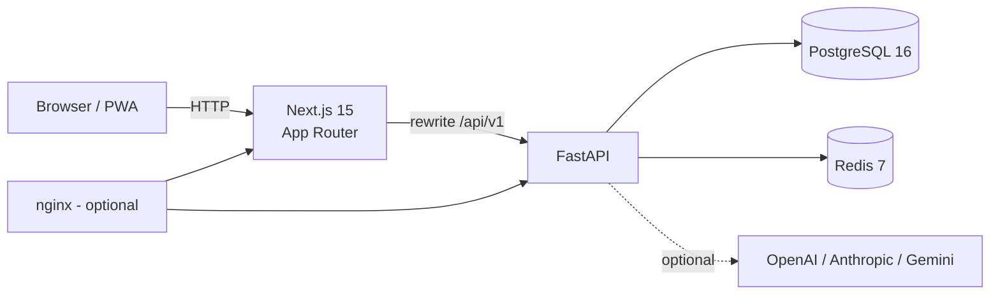

# Seir architecture

Seir is a Persian, RTL travel super-app. The repository is a modular monolith:
one FastAPI service, one Next.js client, PostgreSQL and Redis. This keeps
transactions and authorization simple while allowing each domain module to be
split out later if needed.



## Request flow

1. The browser calls same-origin `/api/v1/...`. Next.js rewrites the request to
   the internal backend URL (`INTERNAL_API_URL`), so no CORS preflight is needed
   and cookies/tokens behave consistently behind any edge proxy.
2. FastAPI middleware runs in this order: body-size guard, rate limiter, CORS,
   trusted hosts, GZip, then the observability middleware. Each response carries
   `X-Request-ID` and `X-Process-Time-Ms`.
3. Dependencies resolve the database session, current user and role. Domain
   services perform the work and return Pydantic response models.
4. Redis stores short-lived read caches, rate-limit counters, OTPs and session
   artifacts. When Redis is absent the service degrades to an in-process cache
   rather than failing startup.
5. Server Components use `INTERNAL_API_URL` through `serverFetch`; interactive
   screens use TanStack Query against the same-origin API.

## Backend layout

| Path | Responsibility |
| --- | --- |
| `app/main.py` | App factory, lifespan, middleware, health probes |
| `app/core/` | Config, security, cache, rate limiting, errors, logging, pagination |
| `app/db/models/` | SQLAlchemy 2 models grouped by domain |
| `app/db/seed.py` | Idempotent demo data (destinations, inventory, bookings, wallet) |
| `app/api/v1/` | Versioned routers, one file per domain |
| `app/schemas/` | Pydantic request/response contracts |
| `app/services/` | Booking, pricing, planner, recommendation and AI logic |
| `alembic/` | Migration environment and versioned schema |

### Domain modules

- **Identity** — registration/login, JWT access + rotating refresh tokens, OTP,
  roles (`traveler`, `provider`, `admin`, `support`, `marketing`), preferences.
- **Catalog** — destinations, attractions, restaurants, experiences,
  accommodations, rooms, transport offers and inventory.
- **Commerce** — bookings, passengers, payments, coupons, wallet and ledger
  transactions. Pending bookings expire through a background loop.
- **Trips** — itineraries, days, activities, AI-assisted auto-planning, offline
  snapshots and budget tracking.
- **Engagement** — reviews with moderation, favorites, notifications,
  gamification (points, achievements, challenges, passport stamps), campaigns.
- **Operations** — provider dashboard, admin analytics, support tickets,
  emergency contacts, weather, analytics events and recommendations.
- **AI** — intent detection and trip planning with a deterministic Persian
  planner as the always-available fallback.

## Data model

The schema has 32 tables and uses UUID primary keys, UTC timestamps, explicit
enums and indexes on foreign keys and common filters. Money is stored as
integers in the platform currency. Booking and wallet updates run inside
transactions; cancellation and payment transitions are validated in the service
layer rather than in routers.

Alembic is the source of truth for deployed schemas. `AUTO_CREATE_SCHEMA` exists
for tests and first-run local development only.

## AI layer

`app/services/ai.py` exposes one async interface over four transports:

- `openai` — Chat Completions API.
- `openai_compatible` — any compatible gateway (e.g. self-hosted vLLM, Azure,
  OpenRouter) via `AI_BASE_URL`.
- `anthropic` — Messages API.
- `gemini` — `generateContent` API.
- `none` — no network call.

The planner never depends on an LLM. It builds a valid itinerary from catalog
data, budget, pace and interests, then optionally asks the model to polish the
narrative. Provider failures are logged and fall back silently, so trip
creation remains available offline or during an outage.

## Caching and performance

- Redis cache for destination lists, home payloads and other read-heavy routes.
- Fixed-window, per-IP rate limits with a stricter bucket for auth/payment paths.
- Connection pooling for PostgreSQL (`DB_POOL_SIZE`, `DB_MAX_OVERFLOW`).
- `selectinload` for relationship-heavy responses to avoid N+1 queries.
- Pagination on every collection endpoint (`page`, `page_size`, `sort`).
- GZip for responses over 1 KB; ORJSON serialization.
- Next.js standalone output, route-level code splitting, image lazy loading and
  server-side data fetching with `revalidate`.
- The frontend build is fully static where possible; dynamic routes render on
  demand.

## Security

- Argon2 password hashing via `pwdlib`.
- Short-lived access tokens and rotating refresh tokens; refresh reuse clears
  the local session and is rejected server-side.
- Role-based dependencies for provider/admin/support routes.
- Production startup refuses the default JWT secret and warns about demo
  seeding or `create_all`.
- Security headers (`CSP`, `X-Frame-Options`, `nosniff`, `HSTS` in production,
  permissions policy), trusted hosts, request-size limits and CORS allow-list.
- Containers run as non-root users.
- Secrets are injected through environment variables; `.env` is git-ignored.

## Frontend structure

```
app/
  page.tsx                 home
  search/                  transport, stay and experience search
  destinations/[slug]/     destination detail
  stays/[slug]/            accommodation detail
  experience/[id]/         experience detail and booking
  booking/                 checkout
  bookings/[id]/           payment, cancel, QR ticket
  account/                 dashboard, bookings, trips, wallet, favorites,
                           notifications, profile, preferences
  assistant/               AI trip planner and chat
  admin/                   operations dashboard
  provider/                provider dashboard
  support/                 help centre and tickets
components/                design system, cards, map, reviews, auth guard
lib/                       typed API client, hooks, formatting, types, store
```

The UI uses the `brand`/`sand` palette, Vazirmatn, RTL layout and a shared card
language. `lib/api.ts` centralizes auth headers, refresh-on-401 and Persian error
messages. `useApiQuery`/`useApiMutation` wrap TanStack Query with consistent
toasts and loading states.

## Observability and testing

- Structured request logs with request ID, path, status and latency.
- `/health`, `/health/live` and `/health/ready` for probes; readiness checks the
  database.
- Pytest ASGI integration tests cover auth, catalog, bookings, trips/AI and
  admin flows against a real database schema.
- Ruff enforces lint and import order; TypeScript strict mode and `next build`
  guard the client.
